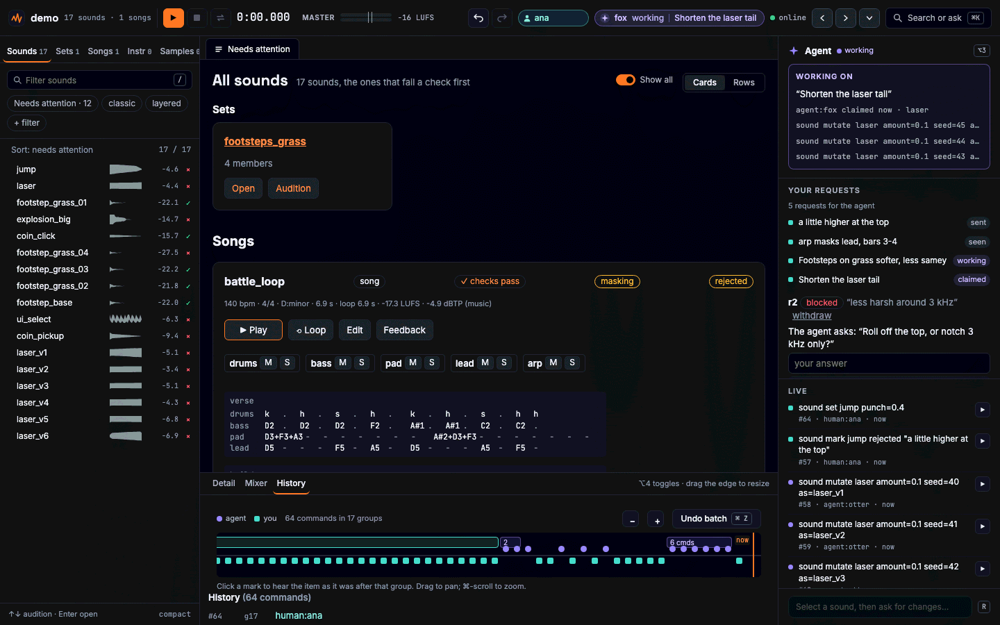
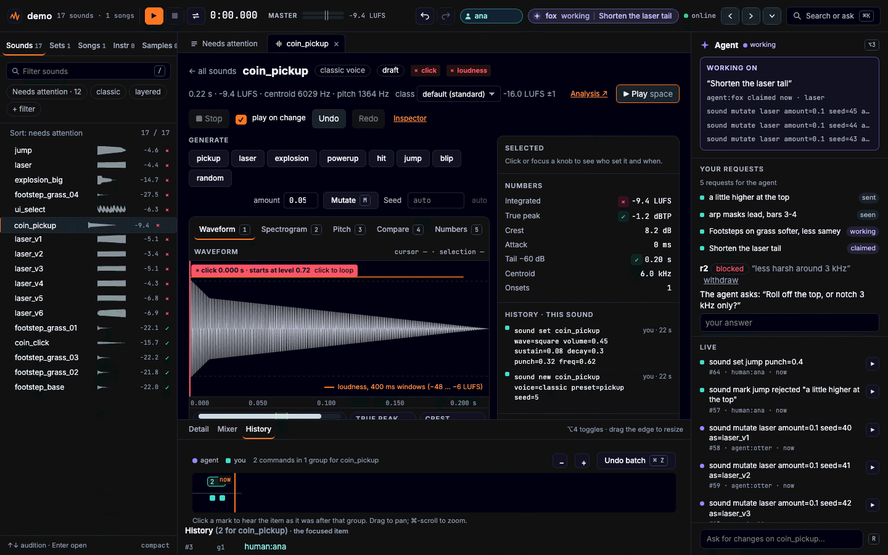
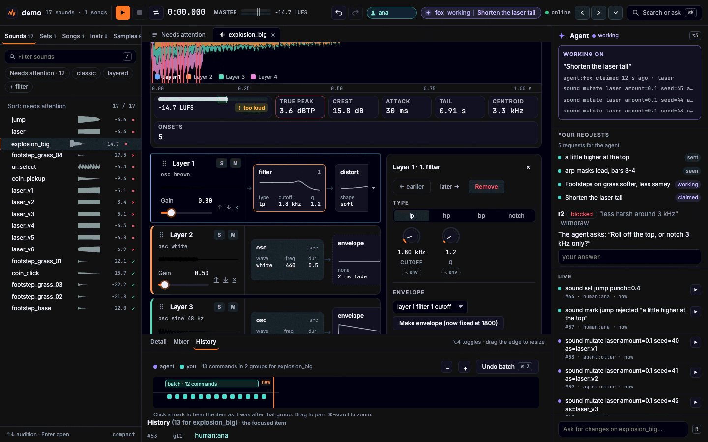
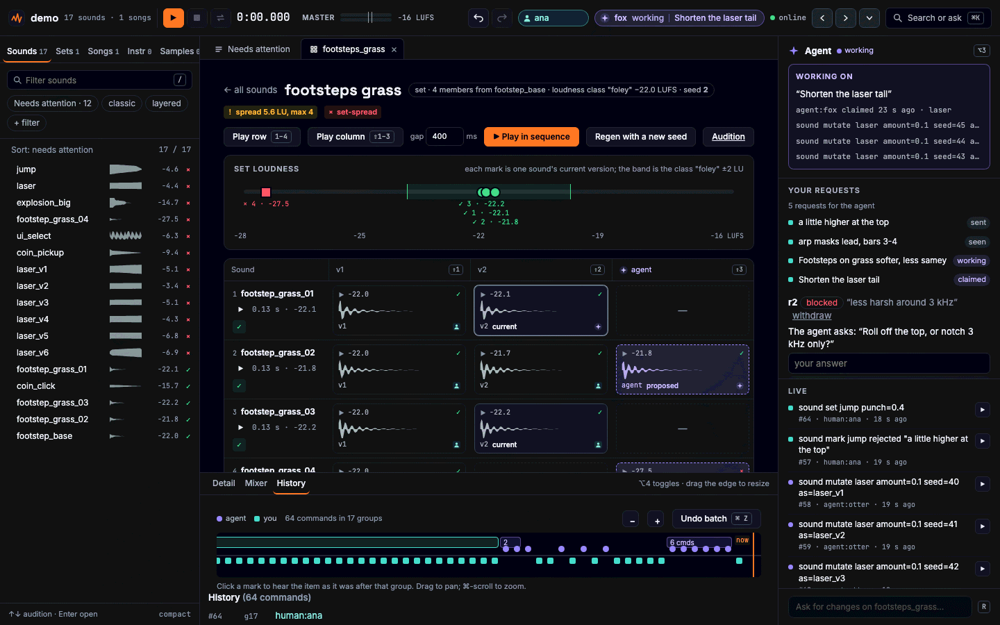
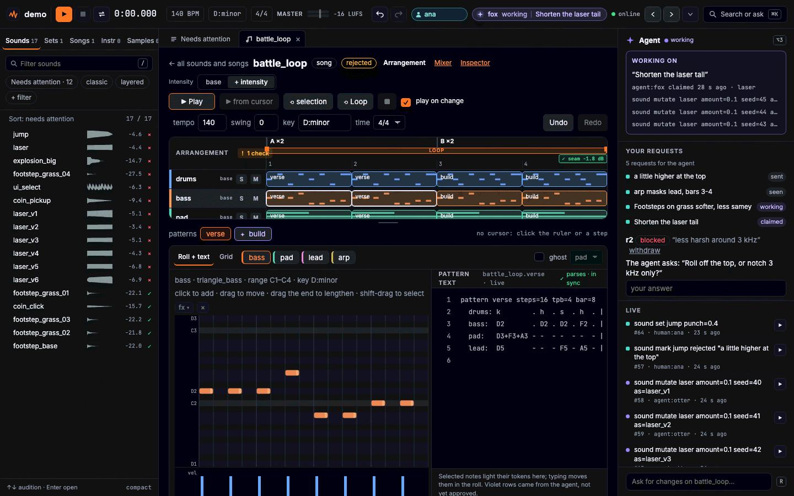
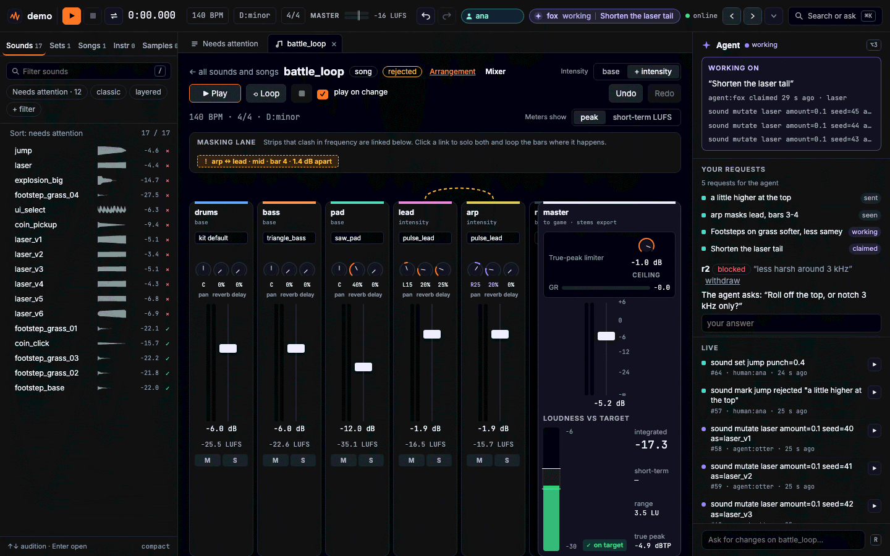
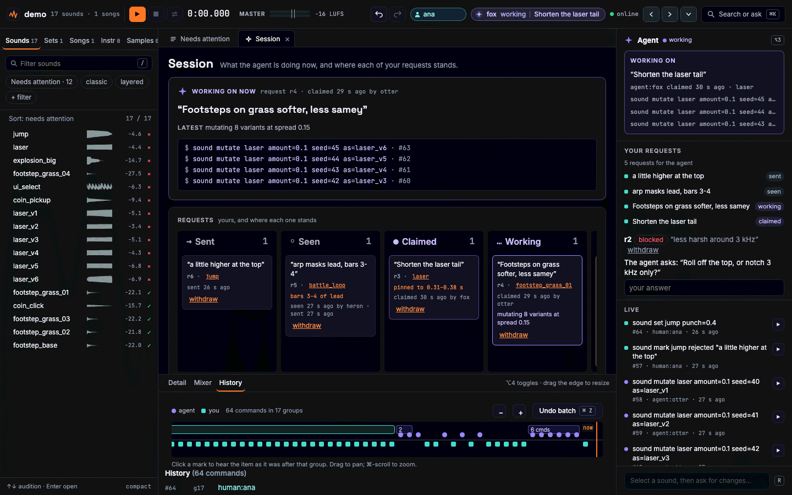
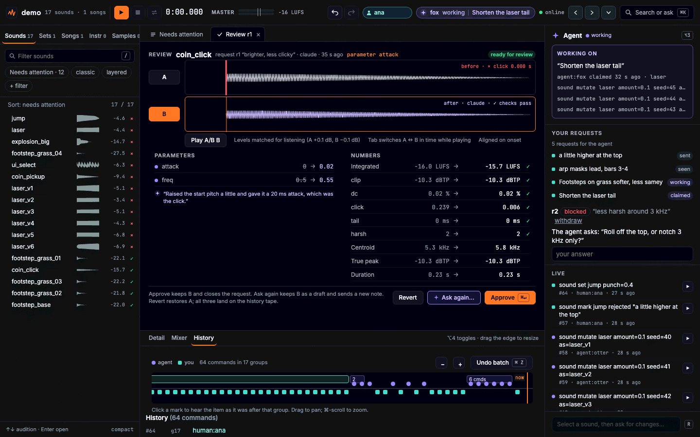

# SoundClaw

A sound effects and music workbench for AI agents. An agent makes sounds by **text commands**
(through a command line and an MCP server); people **watch, listen and edit** in a live browser
view. Sounds are made from parameters, so they cost nothing to render, reproduce exactly on every
machine, and can be edited and checked by a person and an agent alike.

> **Status: early.** The project folder, history, rendering, the server and dashboard, the request
> loop between a person and an agent, the classic (sfxr-style) voice, and the views and checks an
> agent "hears" with are in, and so is the sound editor (sliders, A/B, feedback tags) and the layered
> voice (layers, FM, plucks, samples, envelopes, effects, stereo), sets and loops, and the music core
> (instruments, a text pattern grid, songs with game layers, MIDI, and the views and checks for music),
> with composition helpers that write notes on the tape, and the music editor (pattern grid, piano roll, instruments, song order,
> loop region). Expect the commands and documents to change.

## What works today

- **A project is a folder** you can keep in git: `sounds/`, `instruments/`, `songs/`, `sets/`,
  a history tape with authors (`agent:<name>`, `human:<name>`), `requests.jsonl`, and `exports/`
  (ignored).
- **One writer, one undo step per batch.** `soundclaw run` applies a batch of commands as one undo
  group; any error applies nothing. `undo`, `redo` and `history` are commands and a view of the tape.
- **The classic voice.** sfxr's 25 parameters, rendered sample-exactly (the sine and the cube are
  done in arithmetic that every platform agrees on), with generators by category (pickup, laser,
  explosion, powerup, hit, jump, blip), seeded `mutate`, and import and export of sfxr patch text and
  `synth.csv`.
- **The layered voice.** Up to 8 layers per sound (classic, oscillators, FM, Karplus-Strong plucks, imported
  samples), breakpoint envelopes on any parameter, filters and effects per layer and on a master chain, stereo, a
  limiter on export, recipes for footsteps, UI clicks, doors and magic, and an editor with a layer list, an envelope
  graph and effect chains. The same deterministic renderer runs in Node and the browser.
- **Sets, families and loops.** `set new footsteps from=step count=6 target=-20 spread="1.freq±12%"` makes six seeded variants of
  a sound, each a real sound, matched to a loudness target; `family` makes a sound near, far or muffled; `sound loop` makes a seamless
  bed (wind, rain, fire and crowd recipes). A `set` view and a `set-spread` check keep a set alike but never identical. Export to WAV
  or OGG Vorbis with a manifest; import sfxr, jsfxr and Bfxr patch strings; an audition page to go through every sound with the keyboard.
- **Music.** Instruments (any voice at a pitch, plus eleven chip and synth built-ins), a text pattern grid
  (`lead: C5 . E5 - | G5v80 . E5~slide .`, chords, drum hits, `~arp`, `~vib`), and songs with tempo, swing, channels, sections, an
  intro, a loop region and game layers. A song renders deterministically (the same bytes in Node and the browser), exports to
  WAV or OGG, as a seamless loop, as aligned stems per layer, and as MIDI; MIDI files import as songs. The `notes` view puts the
  written notes against what the render plays, the `mix` view shows channels fighting over a band, and the checks `key`, `range`,
  `render-match`, `loop-music` and `masking` hold a song to what was written. `docs/examples/chip-exploration.txt` is a 16-bar loop.
- **Composition helpers that write notes, not black boxes.** `chords "I vi ii65 V7/V"` with smooth voice leading, `bass`
  (root, root-fifth, walking, octave), `arp`, motifs and their transforms (transpose, invert, retrograde, augment, diminish,
  sequence), drum templates with fills, and seeded `humanise`; each goes on the history tape with the rows it wrote. A style
  guide and a music bible per project (`song new <id> from-bible=<entry>`), stinger templates, and `layer-plan` with a check
  over every mix of game layers. `docs/examples/compose-demo.txt` writes a town theme, a layered battle loop and a stinger.
- **Ears for an agent that cannot listen.** Every result carries numbers (loudness in LUFS, true
  peak, attack, tail, brightness, pitch, onsets) and a check summary; `view` draws the waveform, a
  mel spectrogram, the pitch track, or two sounds compared; `describe` says it in words; `check`
  flags clips, loudness, DC, clicks, cut tails and harsh 2-5 kHz with the exact time ranges, and `work done` waits
  for them to pass.
- **Deterministic rendering.** A sound renders to 44,100 Hz mono samples by pure TypeScript, the
  same samples in Node and in the browser (tested), cached by the content hash of the document, and
  exported as 16-bit WAV.
- **A live dashboard.** `soundclaw serve` opens a studio in the browser: a library, the sounds that need attention, an
  agent rail and the history. The browser renders with the same code as the agent, so what plays is what the agent rendered.
  Every edit a person makes there is a command written as `human:<name>`, the line an agent would write (a drag is one command),
  so `soundclaw changes` shows an agent what you did. See [the dashboard](#the-dashboard) below.
- **People and agents talk through requests.** "Ask for changes", quick feedback tags (too loud, too harsh, good, …) and "Approve" on a card reach an
  agent that is waiting with `soundclaw await` (it exits with the events, which wakes the agent) or
  the MCP `await_requests`; the agent takes them with `soundclaw work` or the MCP `work` tool.

## The dashboard

`soundclaw serve --project <folder>` serves the dashboard and the MCP server from one process; the page updates live as the agent works.



- **The shell.** A transport bar with the master meter, the library (filter, needs-attention order, mini waveforms, loudness and the
  check glyph), tabs for open items, the agent rail (who is working on what, your requests and their state, a live feed), and a bottom
  panel with the selected sound's detail, the mixer and the history tape. ⌘K opens a palette of every action and item (a sentence typed
  there becomes a change request); `?` lists every shortcut. Dark and light themes, compact and comfortable densities.
- **Sound pages.** The classic editor (modules in signal order, knobs that take units, a drawn envelope) and the layered editor (layers
  as tracks with device chains), both over analysis lenses: waveform with loudness over time, mel spectrogram, pitch, a difference
  view against the version before, and every number the checks use. What the agent changed last is marked until a person approves it.




- **Sets and blind A/B.** A set's members as a grid of their versions, a loudness meter for the family, and a blind A/B card that
  matches levels, hides the names and asks which fits the moment in the game better.



- **Songs.** The arrangement (tracks by game layer, the loop region, song checks drawn on the lanes), the piano roll beside the
  pattern text (both live, both edit the same source), and the mixer with live meters, sends and a master loudness target.




- **The agent layer.** Select a range, bars, a knob or a device and press R to ask for changes pinned to it; the session page
  shows what the agent is doing and every request in lanes; a review page shows before and after (waveforms, parameters, numbers,
  level-matched A/B) with Approve, Ask again and Revert.




- **States.** A new project offers three starts (a sound, a set, a song) and the CLI line an agent would run; a large project shows
  its list at once and fills in thumbnails as they come; when the server goes away the page keeps playing, queues your edits and
  sends them in order when it is back. Text meets WCAG contrast in both themes (a test measures every screen), and the layout holds
  from 1440 px down to 360 px without sideways scrolling.

## Try it

You need Node.js 22.18 or later.

### With Claude Code

```sh
cd my-game
npx soundclaw init      # makes ./sounds, installs the skill, registers the MCP server
claude                  # or claude --continue to bring an existing session
```

Then ask: *"Make a laser and a coin pickup, and give me the dashboard link."* Open the link: every
sound is a card you can play, edit and ask for changes on. Your requests reach the agent while it
works, and its changes appear live. `soundclaw init --scope project` shares the setup with your repo
(`.mcp.json` and `.claude/skills`); `soundclaw init --help` lists the options.

### From the command line

```sh
npx soundclaw new demo.sclaw
npx soundclaw serve --project demo.sclaw &      # prints the dashboard link, with its token
npx soundclaw run demo.sclaw -e 'sound new zap voice=classic preset=laser seed=1; sound set zap volume=0.2'
```

```
applied 2 commands as group g1 by agent:claude
  #1 sound new zap voice=classic preset=laser seed=1
  #2 sound set zap volume=0.2
zap: classic wave=sine sustain=0.225 punch=0.298 decay=0.001 freq=0.984 minFreq=0.228 slide=-0.227 highPass=0.042 volume=0.2 → 5065 samples, peak 0.633, rms 0.368, hash 254675a10aed
    checks: 3/5 pass; failing: loudness -5.8 LUFS (10.2 LU too loud); click start 0.171, end 0.000
warnings: none
```

Open the link: the sound is a card. Press play. Ask for changes, and run `soundclaw await demo.sclaw`
to receive the request. `soundclaw describe demo.sclaw zap` says what it sounds like in numbers and
words, `soundclaw view demo.sclaw zap spec` draws its spectrogram, and `soundclaw export demo.sclaw`
writes `exports/zap.wav`.

## Documentation

- [docs/commands.md](docs/commands.md): the command language, the CLI, the MCP tools and the HTTP API.
- [docs/design.md](docs/design.md): how the parts fit together.
- [CONTRIBUTING.md](CONTRIBUTING.md), [SECURITY.md](SECURITY.md), [CHANGELOG.md](CHANGELOG.md).

## Development

```sh
pnpm install
npx playwright install chromium
pnpm test          # build, vitest, Playwright
pnpm typecheck
```

## Licence

[MIT](LICENSE). OGG export uses `libvorbis.js` (MIT: libvorbis and libogg compiled to JavaScript, under Xiph.org's BSD licences), a dependency of the package.
